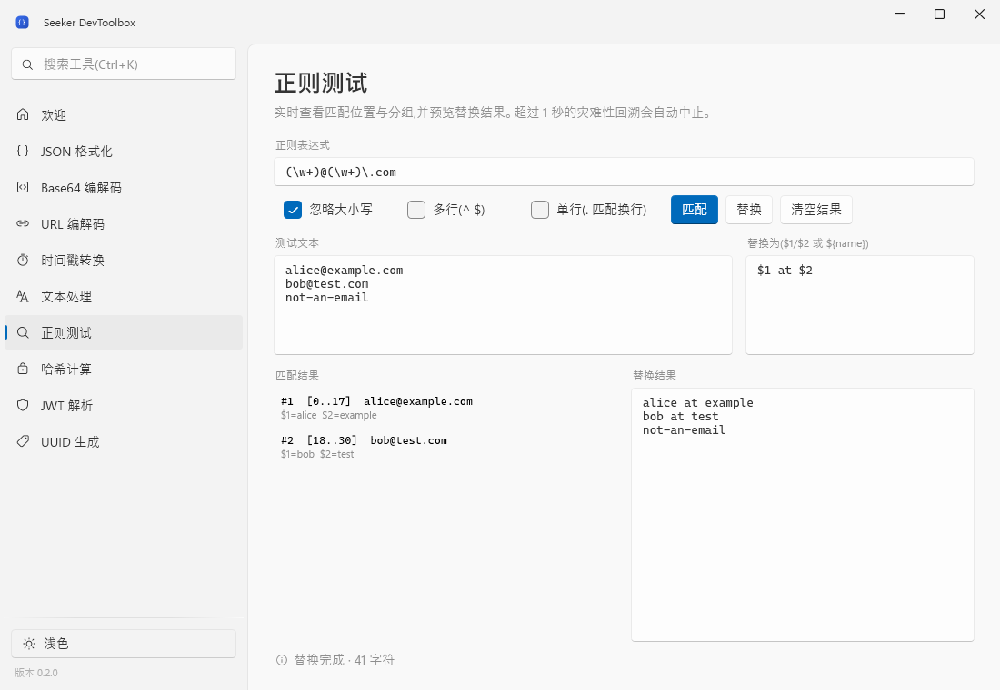
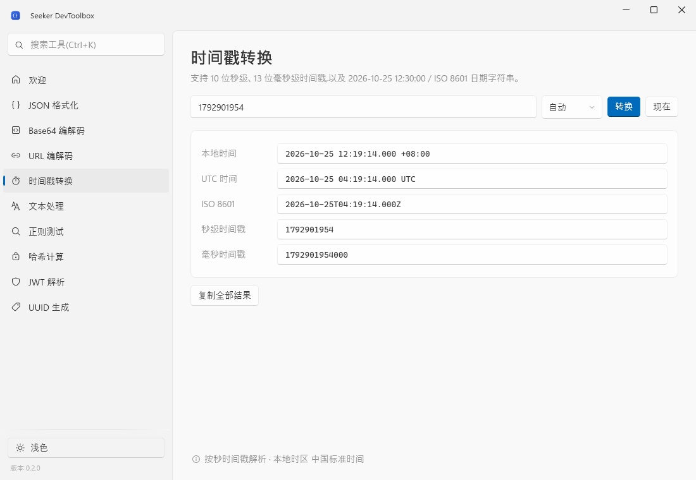
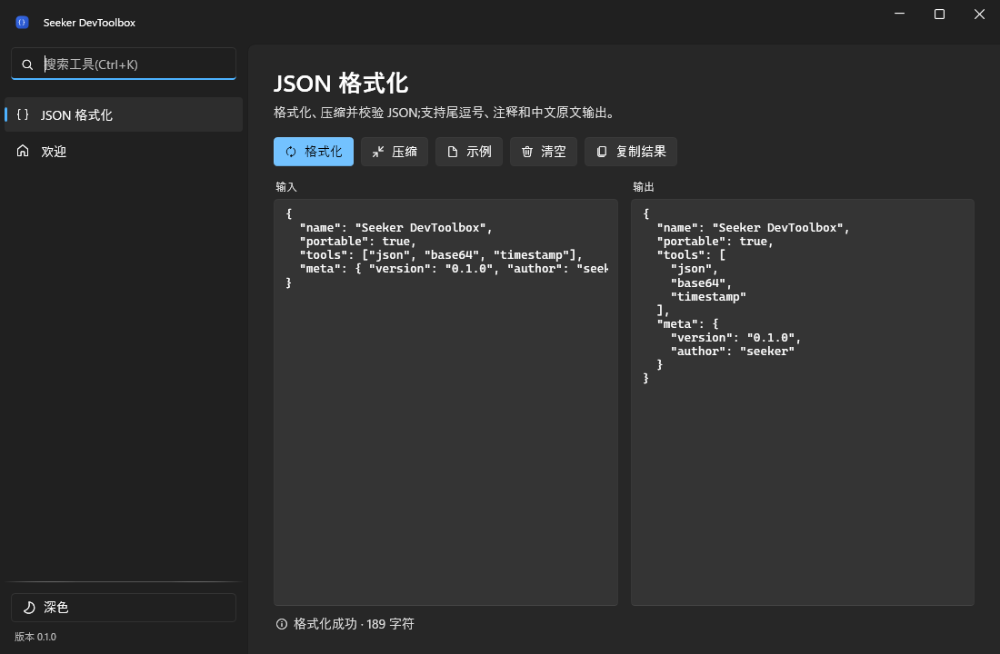

# Seeker DevToolbox

Windows 开发者工具箱,**免安装、离线可用**。基于 .NET 10 + WPF + WPF-UI,自包含发布,目标机无需安装任何运行时。




## 当前状态(M1 已完成)

- [x] Fluent 主窗口:WPF-UI `FluentWindow` + Win11 Mica + 圆角
- [x] 左侧 `NavigationView`:搜索过滤、最近使用排序、快捷键 `Ctrl+K`
- [x] 深色 / 浅色 / 跟随系统三种主题,自动持久化
- [x] 设置、日志、窗口尺寸写入数据目录,不写注册表
- [x] 单实例运行,重复启动唤起已有窗口
- [x] 全局异常兜底 + Serilog 滚动日志
- [x] 工具模块化:`IToolModule` 契约 + 按需创建、缓存视图
- [x] 绿色版发布脚本(目录版 + 单文件 exe + zip + SHA256)
- [x] 84 个 Core 单元测试
- [x] 10 个工具全部通过真实点击冒烟测试

### 工具清单

| 分类 | 工具 | 能力 |
|---|---|---|
| 常用 | 欢迎 | 运行模式、数据目录、快捷键提示 |
| 数据 | JSON 格式化 | 格式化 / 压缩 / 校验,支持尾逗号、注释 |
| 编码 | Base64 编解码 | UTF-8 文本互转,URL-safe 变体 |
| 编码 | URL 编解码 | 组件级编码/解码,表单 `+` 空格语义 |
| 时间 | 时间戳转换 | 秒/毫秒/自动识别,日期 ↔ 本地/UTC/ISO 8601 |
| 文本 | 文本处理 | 驼峰/Pascal/下划线/短横线/常量、排序、去重、去空行、加行号 |
| 文本 | 正则测试 | 匹配位置、分组、替换预览,超时保护 |
| 安全 | 哈希计算 | MD5 / SHA-1 / SHA-256 / SHA-512,HMAC |
| 安全 | JWT 解析 | Header/Payload 解码,exp/nbf 检查 |
| 生成 | UUID 生成 | UUID v4 / v7,批量、大小写、连字符 |





## 快速开始

要求:Windows 10 1809+ / Windows 11(x64),PowerShell 5.1+。

```powershell
# 1. 安装项目专用 .NET SDK 到 .dotnet/(无需管理员权限,约 300MB)
.\build\install-dotnet.ps1

# 2. 本地运行
.\build\run.ps1

# 3. 跑测试
.\build\test.ps1
```

## 发布免安装版本

```powershell
# 目录绿色版(推荐):启动快,便于增量替换
.\build\publish.ps1

# 单文件 exe:方便转发,首次启动会解压到 %TEMP%,略慢
.\build\publish.ps1 -SingleFile
```

产物在 `artifacts/`:

```
artifacts/
├─ Seeker.DevToolbox-0.2.0-portable/        # 目录绿色版
├─ Seeker.DevToolbox-0.2.0-single/          # 单文件版
├─ Seeker.DevToolbox-0.2.0-portable-win-x64.zip
├─ Seeker.DevToolbox-0.2.0-single-win-x64.zip
└─ SHA256SUMS.txt
```

目录版自带 `portable.marker`,运行时数据写在程序目录的 `data/` 下:

```
data/
├─ settings.json
├─ logs/app-20261025.log
└─ ...
```

- 迁移:复制整个文件夹。
- 卸载:删除整个文件夹。
- 删除 `portable.marker` 后,数据改写到 `%LOCALAPPDATA%\Seeker\DevToolbox`(适合放在只读目录)。
- 单文件版如需便携模式,在 exe 同级手动创建空文件 `portable.marker`。

> 未签名 exe 首次运行可能被 SmartScreen 拦截,这是预期行为;分发时请附上 `SHA256SUMS.txt`。

## 项目结构

```
Seeker.DevToolbox.sln
├─ src/
│  ├─ Seeker.DevToolbox.Core/        # 纯逻辑,无 WPF 依赖,可单测
│  ├─ Seeker.DevToolbox.UI/          # IToolModule 契约、主题、通用控件
│  ├─ Seeker.DevToolbox.Tools/       # 各工具模块(View + ViewModel + Module)
│  └─ Seeker.DevToolbox.App/         # WPF 宿主:DI、导航、单实例、日志
├─ tests/Seeker.DevToolbox.Core.Tests/
├─ build/                            # 构建/发布/图标脚本
├─ docs/                             # 方案与截图
└─ .dotnet/                          # 本地 SDK(已 gitignore)
```

## 新增一个工具

1. 在 `Core` 写纯逻辑,并补单元测试。
2. 在 `Tools` 下新建 `XxxToolView.xaml` + `XxxToolViewModel`。
3. 实现模块:

```csharp
public sealed class XxxToolModule : IToolModule
{
    public ToolMetadata Metadata { get; } = new(
        Id: "xxx",
        Title: "工具名称",
        Category: ToolCategories.Text,
        Glyph: "TextFont24",              // Segoe Fluent Icons 名称
        Description: "一句话说明",
        Keywords: ["xxx", "关键词"]);

    public FrameworkElement CreateView(IServiceProvider services) => new XxxToolView();
}
```

4. 在 `Tools/ToolCatalog.cs` 的 `CreateModules()` 里追加一行。

ViewModel 继承 `ToolViewModelBase` 即可复用状态栏、错误标记和剪贴板操作;页面统一使用 `ToolPageHeader` / `ToolStatusBar` 和 `ToolStyles.xaml` 里的样式。

导航、搜索、最近使用、设置持久化会自动生效。

## 技术栈

| 领域 | 选型 |
|---|---|
| 运行时 | .NET 10 LTS |
| UI | WPF + WPF-UI 4.3 |
| MVVM | CommunityToolkit.Mvvm |
| 宿主/DI | Microsoft.Extensions.Hosting |
| 日志 | Serilog(滚动文件) |
| 测试 | xUnit |
| 发布 | `dotnet publish` 自包含 + PowerShell 脚本 |

## 已知限制 / 下一步

- 单文件版首次启动较慢(`%TEMP%` 解压),日常使用建议目录版。
- 文本编辑目前是普通 `TextBox`;M2 会换成 AvalonEdit(语法高亮 + 折叠)。
- 未做自动更新与代码签名。
- M2 计划:文本 Diff、颜色转换、AvalonEdit、文件哈希、YAML/XML 格式化、Base64 文件互转。

详细选型与架构见 [docs/技术选型与架构方案.md](docs/技术选型与架构方案.md)。
